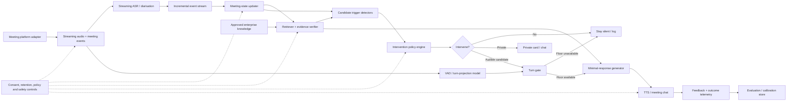
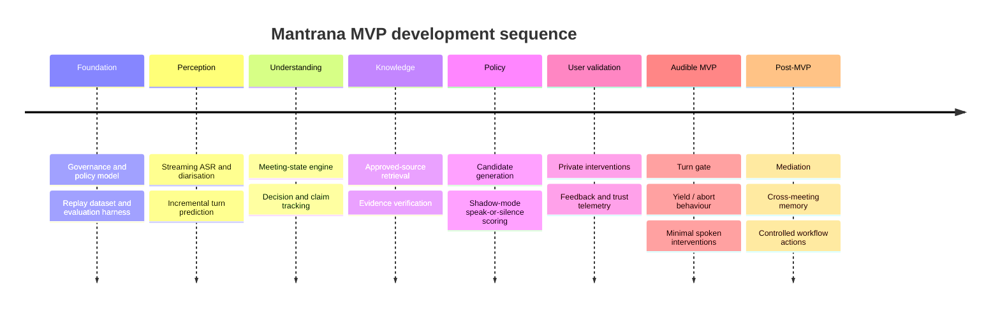

# Mantrana spec — external research, filed for reference

Pasted into a UAT/dev session on 2026-10-12 as a follow-up to live testing of ThirdSeat.
Not yet adopted as product direction; saved here so it isn't lost, and so the gap
analysis below can be revisited before any of it is built.

## Gap analysis vs. ThirdSeat's current implementation (as of this commit)

Checked against the actual codebase, not from memory.

### Already implemented (matches this spec's thesis)

| Mantrana idea | Where in ThirdSeat |
|---|---|
| Silence is the default state | `src/gaps/engine.ts` — "stand down" / `NATURALLY_RESOLVED` path, no card shown when nothing qualifies |
| Grounding precedes assertion | `evidence[]`, `citedEvidenceIds`, `confidence: HIGH/LIKELY/UNVERIFIED`, `tierForUrl` source ranking |
| Let humans self-correct before intervening | `settleSpeculative`, speculative research discarded/cancelled on natural resolution |
| Private precedes public when uncertain | `speakable()` in `src/voice/composer.ts` — only `HIGH`/`LIKELY` confidence KNOWLEDGE gaps may be spoken; everything else stays screen-only |
| Minimum useful contribution / BLUF | `MAX_SPOKEN_WORDS = 40`, signpost-style templates in `templateFor()` ("I checked that one — …", "Going back to … — …") |
| Structured state (≈ D/A/Q) | `gaps` (KNOWLEDGE/OPEN_THREAD/DECISION/DRIFT/REASONING/EVIDENCE), `facts`, `assumptions` in `state.ts` |
| Turn-boundary / yield behaviour | `VoiceAgent`: waits for `silenceMs` of human silence, yields instantly if a human starts speaking, never repeats itself |
| Per-candidate audit trail | `gap.decisionLog[]` — every gap logs why it was or wasn't surfaced |
| Human feedback loop | `FEEDBACK_FLAGS`, `userActions` (USED/DISMISSED/MARK_RESOLVED/INCORRECT etc.) |
| Deferral / uncertainty handling | `ResponseKind`: CONFIDENT_ANSWER / WEAK_ANSWER / UNCERTAIN / DEFERRAL / ACKNOWLEDGE |
| Proactive research starts immediately | `startProactiveResearch()` fires the instant a FACTUAL question is detected, held until it qualifies |

### Real gaps (not built, would be new value)

1. **Predictive turn-taking.** Voice currently uses a fixed `silenceMs: 1500` wait (`src/voice/voice-agent.ts`), not a VAD/TurnGPT-style floor-availability prediction. This is an audio-modeling project, not a prompt change.
2. **NIV-style multi-factor intervention scoring** (grounding × relevance × value × urgency − harm − interruption − redundancy − agency cost). Current `basePriority()` is a simpler heuristic, not this explicit formula.
3. **EU AI Act / GDPR compliance layer.** No AI-participant disclosure, no configurable retention, no DPIA-oriented controls. ThirdSeat already avoids emotion/culture inference (good by omission, not by designed policy), but has nothing else from this list.
4. **Shadow-mode / continuous calibration harness.** `decisionLog` explains individual gaps, and `scripts/rigorous-three-modes.ts` + `scripts/phrasing-probes.ts` already score against a held-out answer key — but there's no live, ongoing "log every suppressed candidate too" evaluation loop of the kind this spec describes.
5. **Admin-exposed policy modes** (silent / private / conservative audible / facilitator). Today's knobs (`proactiveResearch`, `minPriority`, etc.) are config-file/env-var level, not a surfaced per-meeting control.

### Explicit non-recommendation

Importing this spec's raw human-to-human silence thresholds (600–800 ms "feels reluctant", 4 s "feels like rejection") into the KNOWLEDGE-gap timers (`proactiveGraceMs`, `watchMs`, `retroactiveAfterMs`) would make ThirdSeat worse, not better — those numbers describe a different problem (one human's delay answering another human) than "how long should the group get before an ambient third party assumes nobody will answer." Already discussed and rejected in this session.

---

## Full source document (as received)

Mantrana: Product Specification for a Grounded, Low-Interruption AI Meeting Agent

### Executive summary

The existing critique is directionally correct, but it should be sharpened into a much stricter product thesis:

> **Mantrana is not a meeting notetaker that occasionally gives advice. It is a decision-aware meeting participant whose default action is silence, and whose purpose is to surface the minimum evidence or question capable of improving a live decision.**

The source playbook contains the right raw ingredients: distinguish the stated ask from the underlying job; detect when a decision is pending; provide the one fact that changes that decision; enter at a natural turn boundary; structure contributions bottom-line-first; and capture decisions, actions and unresolved questions. Those ideas should form roughly **30% of the conceptual content of the original document and nearly 100% of Mantrana's core reasoning philosophy**. Camera etiquette, personal recall coaching, national-culture heuristics, sarcasm decoding, small talk, humour and executive-presence advice should not sit inside the core agent.

This focus also gives Mantrana a clearer competitive position. By late 2026, Microsoft Teams Facilitator already creates live notes, summarises decisions and open questions, tracks agendas and time and manages tasks; Google Meet captures notes and next steps; ZoomMate uses meeting context for enterprise search and workflow execution; and Otter's Live Assist provides real-time, in-call coaching. Simply adding transcription, summaries, agenda tracking or action-item extraction therefore produces a largely undifferentiated meeting assistant.

The differentiation should instead be:

**live meeting state → decision relevance → evidence retrieval → intervention value → social timing → smallest useful contribution**

Research supports treating **when not to speak** as a first-class capability. A CHI 2025 study found passive meeting interventions could maintain focus non-intrusively, while active interventions prompted action but could disrupt conversational flow. Recent multi-party research likewise finds that treating every pause as a speaking opportunity is inadequate; *Speak or Stay Silent* reports substantial gains from explicitly training the speak-versus-silence decision rather than relying on zero-shot LLM behaviour.

The most directly relevant frontier result is the October 2026 **Jarvis** preprint, published only days before this report. Jarvis follows multi-party conversations, intervenes when participants miss or misstate a fact, waits to see whether the group self-corrects and grounds each claim in a supplied source sentence. It reportedly remained silent on 97% of cases where humans resolved the issue themselves. This is unusually close to Mantrana's intended behaviour; because it is a very recent preprint rather than established peer-reviewed evidence, it should be treated as high-priority prior art rather than a proven blueprint.

#### Recommended MVP in one sentence

**An audio-first, enterprise meeting agent that maintains a structured live model of goals, decisions, claims, evidence gaps and commitments; retrieves evidence from approved sources; and surfaces either a private nudge or a short audible intervention only when expected decision value exceeds interruption, error and agency costs.**

#### Open assumptions

| Area | Working assumption for this specification |
|---|---|
| Deployment | Platform-neutral core with Teams/Zoom/Meet adapters; no commitment yet to bot, native application or local-client architecture. |
| Latency | Low enough for incremental processing is required, but no end-to-end SLA should be fixed until the target platform and model stack are benchmarked. |
| Privacy | Assume enterprise meetings, potentially including EU/UK users, and therefore design for minimisation, transparency, configurable retention and explicit meeting-level controls from the outset. |
| Modality | **Audio + transcript + meeting metadata first.** Video is unnecessary for the MVP and materially expands privacy and modelling complexity. |
| Knowledge | Autonomous factual interventions should initially be grounded only in approved documents, enterprise data and explicit meeting artefacts. Open-web retrieval should be separately policy-controlled. |
| Agency | MVP may propose, clarify and flag. It should not autonomously make organisational commitments, assign work to humans or execute consequential actions. |

The central product rule should therefore be:

> **Mantrana earns the right to speak; it does not earn the right to listen and therefore assume it should speak.**

### Product specification and scope

#### Product objective

For each evolving discussion, Mantrana should answer five internal questions:

1. **What are these people trying to accomplish?**
2. **What decision, commitment or unresolved question is currently live?**
3. **What does the group presently believe?**
4. **Is there trusted information or a missing question that could materially improve the outcome?**
5. **Is saying it now more valuable than allowing the humans to continue?**

This converts the strongest part of the source playbook—stated ask → real ask → pending decision → JITK → minimum useful answer—into an executable product model rather than a human communication manual.

#### Product invariants

The following should be treated as architectural rules, not prompting preferences.

**Silence is the default state.** A pause is not permission to talk. Recent multi-party work explicitly identifies abundant, ambiguous pauses as a central failure case for conventional voice agents.

**Decision relevance outranks topical relevance.** Knowing something related to the conversation is insufficient. Mantrana needs evidence that the information affects the current decision, commitment, question or material assumption.

**Grounding precedes assertion.** An unsolicited factual correction should carry traceable evidence. Jarvis's particularly useful design choice is to combine model reasoning with deterministic checks while tying interventions to source sentences.

**Private precedes public when the benefit is uncertain.** This follows both the CHI finding that active interventions create greater flow-disruption risk and the obvious reversibility advantage of a private card over interrupting an entire room.

**Minimum useful contribution.** Audible output should normally contain: bridge → fact/question → consequence. Supporting detail stays on screen or is offered on demand.

**Humans retain agency.** Mantrana can surface evidence, expose disagreement and ask a criterion question; it should not silently convert a recommendation into a decision or commitment. Human review is especially important because automation bias can cause users of decision-support systems to stop independently questioning system output.

**No emotion, personality or national-culture inference in the core.** Apart from questionable reliability and stereotyping risk, emotion recognition in EU workplaces is expressly prohibited except for specified medical or safety purposes.

#### Feature and content priority

The "core share" below is a functional interpretation of the requested 25–35%, not a literal word-count of the uploaded document.

| Source idea / capability | Product disposition | Priority | Core reasoning role |
|---|---|---:|---|
| Stated ask → underlying objective | **Keep in core** | P0 | Maintains the meeting's actual objective and prevents surface-level answering. |
| Detect pending decision | **Keep in core** | P0 | Primary unit around which intervention relevance is calculated. |
| JITK: one fact at decision point | **Keep in core** | P0 | Fundamental intervention-generation policy. |
| Claims, assumptions, contradictions | **Keep in core** | P0 | Enables factual correction and missing-evidence triggers. |
| Open questions | **Keep in core** | P0 | Detects unresolved uncertainty and explicit information demand. |
| D/A/Q: decisions/actions/questions | **Keep in core** | P0 | Compact structured meeting memory. |
| Owner / due date / definition of done | **Keep in core** | P0/P1 | Commitment-completeness detector; normally private first. |
| BLUF / short structured response | **Keep in core** | P0 | Output compression policy. |
| Turn-boundary awareness | **Keep in core** | P0 | Governs whether and when audible output is permitted. |
| Deferral / uncertainty handling | **Keep in core** | P0 | Critical abstention behaviour. |
| Agenda / time tracking | **Support feature** | P1 | Useful but already well-covered by Teams Facilitator and others. |
| Transcription, summary, generic actions | **Baseline infrastructure** | P1 | Needed operationally, but not Mantrana's differentiator; Google and Microsoft already offer these capabilities. |
| Personal recall coaching | **Optional UX/training** | P2 | Useful to individual users, not part of meeting intelligence. |
| Camera/Zoom etiquette | **Drop from product core** | — | Human training material only. |
| Small talk / humour / executive presence | **Optional training** | — | No role in decision-state reasoning. |
| National culture rules | **Drop from inference engine** | — | Too coarse for person-level inference; creates stereotyping and representational-risk concerns. The ICO explicitly treats stereotyping and representational harm as AI-governance considerations. |
| Sarcasm/tone classification | **Do not use as a speaking trigger** | — | Too uncertain; better to ask a neutral clarifier when semantic ambiguity is decision-relevant. |
| Emotion recognition | **Exclude** | — | Legal and product-risk problem for EU workplace deployment. |
| Generic "sounding human" coaching | **Optional UX** | P2 | Could inform voice design later, but should not control factual intervention decisions. |
| Deadlock/mediation intelligence | **Later core extension** | P2 | Promising but substantially harder than factual JITK; ProMediate shows this is an emerging research problem in its own right. |

The result is a clean split: **approximately one-third of the source playbook becomes reasoning architecture; another small portion may become optional personal coaching; the rest should not affect autonomous behaviour.**

This matters competitively. Microsoft Facilitator now tracks agenda progress, extracts meeting goals, summarises open questions and captures tasks; ZoomMate explicitly turns meeting context into enterprise actions; Otter Live Assist already supplies private in-the-moment guidance. Mantrana should therefore resist feature creep into "yet another AI meeting workspace".

### Autonomous intervention policy

The intervention policy should be implemented as a **policy engine with hard gates**, not as a single LLM prompt saying "decide whether to speak".

#### Candidate triggers

| Trigger | Example | Normal first channel | Audible escalation condition |
|---|---|---|---|
| **Direct invocation** | "Mantrana, what did Security say about this?" | Audible or requested channel | User explicitly grants the floor. |
| **Grounded factual contradiction** | "The blocker is closed", while approved tracker says open | Private or audible | High grounding + high decision relevance + humans fail to self-correct. |
| **Missing decision-critical constraint** | Team compares vendors but omits mandatory EU residency | Private → audible | Decision appears imminent and omission can materially alter choice. |
| **Unresolved ambiguity** | "Friday" could mean code complete or production launch | Question | Ambiguity affects ownership, deadline, scope or decision interpretation. |
| **Decision-criteria conflict** | One side optimises cost; another auditability | Private question → audible | Discussion is cycling and criterion conflict is sufficiently clear. |
| **Incomplete commitment** | Action agreed, but no owner or due date | Private | Audible mainly at explicit wrap-up or when facilitator mode is enabled. |
| **High-severity policy/compliance issue** | Proposed action conflicts with approved policy | Private/audible according to policy | Strong authoritative grounding and material downside from silence. |
| **Process deadlock** | Same positions repeated without new information | Private initially | Later-stage feature; requires much stronger discourse modelling. |

The **suppression triggers** are at least as important: human self-correction, insufficient evidence, active speaker, expected human answer, low ASR certainty on a critical entity/number, recently repeated information, cooldown budget exhausted, restricted meeting type or a user/admin "do not intervene" policy.

#### Decision formula

For each candidate \(c\), compute a normalised intervention value:

\[
\text{NIV}(c)
=
G \times D \times V \times U
-
\left[
(1-G)\times H
+
I
+
R
+
A
\right]
\]

where:

- \(G\) = **grounding confidence**: confidence that the underlying factual proposition is supported by allowed evidence;
- \(D\) = **decision relevance**: probability the candidate materially bears on the live decision/question;
- \(V\) = **expected value**: estimated magnitude of avoiding an error, improving a choice or resolving uncertainty;
- \(U\) = **urgency**: how much the value decays if Mantrana waits;
- \(H\) = **harm if wrong**;
- \(I\) = **interruption cost**: floor competition, meeting sensitivity, speaker momentum and frequency budget;
- \(R\) = **redundancy/self-correction likelihood**;
- \(A\) = **agency cost**: risk that the intervention improperly substitutes for human judgement.

This is intentionally a **policy score rather than a claim of mathematically exact expected utility**. Initial coefficients and thresholds should be treated as engineering priors, then calibrated against labelled meetings and A/B evidence. ProMediate is useful prior art here because it explicitly evaluates proactive agents on intervention timing, effectiveness and consensus effects rather than response accuracy alone.

#### Proposed confidence gates

These are recommended MVP starting values, **not empirically established universal thresholds**.

| Mode | Minimum grounding \(G\) | Minimum decision relevance \(D\) | Additional policy |
|---|---:|---:|---|
| Directly asked | 0.75 | 0.50 | Below threshold: clarify, cite uncertainty or abstain rather than fabricate. |
| Proactive private nudge | 0.80 | 0.65 | NIV must be positive. |
| Proactive audible intervention | **0.92** | **0.85** | Expected value must be material; interruption gate and provenance mandatory. |
| High-stakes compliance/legal assertion | **0.97** | **0.90** | Require authoritative approved source; otherwise turn assertion into a question/private warning. |

Do not treat an LLM's token-level or self-reported "confidence" as \(G\). Grounding confidence should combine independently observable signals: retrieval score, source authority/freshness, entailment between source and proposed claim, agreement across sources, ASR confidence on the relevant entity/number and confidence in the meeting-state interpretation.

#### Timing policy

Natural conversation moves much faster than a naïve "wait for a silence" strategy suggests. Stivers and colleagues found a cross-language mean response offset of about **208 ms**, with turn-transition modes clustered between 0 and 200 ms. That implies that a natural system must begin predicting upcoming floor availability before a speaker has fully finished rather than waiting several seconds after silence begins.

This is technically feasible as a separate fast-path model. Skantze's continuous turn-taking work predicts future voice activity; TurnGPT showed that dialogue context and pragmatic completeness improve turn-shift prediction; Microsoft's 2026 RESPOND framework combines streaming ASR and incremental semantics to predict both when and how to interject.

For Mantrana, the policy should be:

**Prepare early, speak late.** Semantic reasoning and TTS preparation can occur while the current speaker is completing a thought. Audio emission remains blocked until the turn gate grants permission.

**Give humans a self-correction grace window.** For unasked factual corrections, allow roughly **one to three conversational turns**, unless waiting risks an immediate consequential action. This mirrors the promising design in the new Jarvis work, which specifically waits to see whether humans resolve a factual problem themselves.

**Predict floor availability instead of relying on a fixed silence.** A useful initial gate is:

```text
predicted floor-free probability over next ~600 ms >= 0.80
AND current speaker appears pragmatically complete
AND nobody has been directly selected to answer
AND no human speech onset has begun
AND audible intervention budget remains
```

The `0.80` is an MVP tuning prior, not a conversational universal.

**Yield instantly on collision.** If another participant starts, Mantrana cancels or fades its turn and returns the candidate to the queue. Human-human conversation includes repair mechanisms for overlap; Mantrana should be more deferential than another human participant, not less. Continuous turn-prediction research is designed precisely to distinguish turn shift, holding and backchannel opportunities.

**Use a proactive speech budget.** As an initial conservative policy, permit at most one ordinary unsolicited audible intervention per agenda item or approximately every 60–90 seconds, whichever is more restrictive, while allowing overrides for genuinely high-severity events. This should later be learned from disruption data, not permanently hard-coded.

**Expose proactivity as a controlled policy parameter.** RESPOND's useful design precedent is to expose separate controls for backchannel intensity and "turn claim aggressiveness"; Mantrana can analogously expose `silent / private / conservative audible / facilitator` modes without changing the underlying meeting intelligence.

#### Safety and fallback behaviours

When evidence is insufficient, **ask rather than assert**:

> "I may be missing context: does 'Friday' mean code complete or production release?"

When ASR uncertainty affects a critical number or entity:

> "I heard either £15,000 or £50,000. Which one should I use?"

When approved sources disagree:

> "I have conflicting records: the security review still lists SEC-42 open, while the tracker marks the epic complete. Which source should govern this decision?"

When a user requests a consequential action:

> "I can draft the action as 'Priya to obtain Compliance approval by Friday'. Shall I record that?"

For HR, legal, medical, disciplinary, performance-review or similarly sensitive meetings, the safest default is **private/passive support unless an organisation explicitly enables a stronger mode**. This is especially important where AI output may affect individuals, because regulators emphasise meaningful human involvement and the risk of automation bias.

Every intervention should retain an audit record containing the state snapshot, trigger, evidence IDs, confidence components, channel decision and eventual user feedback. NIST's AI Risk Management Framework emphasises lifecycle risk management rather than treating model performance as the entire safety problem.

### Minimal architecture and state model

The MVP should separate **fast conversational control** from **slower semantic reasoning**. Trying to make one large model simultaneously transcribe, reason, retrieve, assess social timing and decide when to speak makes latency, debugging and evaluation unnecessarily opaque.



The choice to isolate a turn-projection path is consistent with TurnGPT and continuous voice-activity prediction research, while the separate semantic policy reflects the finding that multi-party "speak or stay silent" decisions require contextual reasoning beyond pause detection.

#### Minimal component responsibilities

**Meeting adapter:** receives audio, roster, participant join/leave, chat, agenda and—where permitted—shared meeting artefacts.

**Streaming ASR/diarisation:** emits partial turns with speaker and word/entity uncertainty. It should retain confidence for decision-critical tokens rather than flattening everything into a transcript.

**Turn projector:** predicts continue/shift/available-floor probabilities from acoustic and, where useful, incremental linguistic features. No video should be required in MVP.

**State updater:** converts transcript events into durable structured entities rather than repeatedly re-reading the full transcript.

**Retriever/evidence verifier:** searches only policy-approved sources and returns atomic supporting passages with source, timestamp/version and entailment score.

**Trigger detectors:** identify candidate contradictions, omissions, decision events, unresolved questions and incomplete commitments.

**Policy engine:** implements hard safety gates, the net-intervention calculation, channel escalation and suppression rules.

**Renderer:** produces one- or two-sentence BLUF interventions, with supporting evidence visible but not spoken unless requested.

**Evaluation/audit layer:** logs both interventions **and suppressed candidates**, because learning to remain silent cannot be evaluated from spoken output alone.

#### State model

| State object | Essential fields | Why it exists |
|---|---|---|
| `meeting` | ID, mode, policy, participants, elapsed time | Global policy and lifecycle context |
| `goal` | stated goal, inferred underlying job, confidence | Determines relevance |
| `topic` | current topic, parent topic, agenda item | Local context |
| `decision` | question, status, options, criteria, leaning, deadline | Main intervention anchor |
| `claim` | speaker, proposition, ASR confidence, factual status, evidence | Contradiction/grounding |
| `assumption` | proposition, speaker/source, confidence | Exposes hidden premises |
| `question` | text, asker, addressee, resolved? | Tracks explicit demand |
| `action` | task, owner, due date, done-definition, status | Commitment closure |
| `knowledge_gap` | type, severity, relevant decision, source availability | Candidate-generation input |
| `turn_state` | active speaker, predicted completion, floor probability | Timing |
| `candidate` | trigger, scores, evidence, channel, status | Intervention policy |
| `timeline` | timestamped state-changing events | Replay, evaluation and audit |

A representative state object could look like this:

```json
{
  "meeting_id": "mtg_2026_10_12_001",
  "policy": {
    "mode": "conservative",
    "proactive_private": true,
    "proactive_audible": true,
    "approved_sources_only": true,
    "emotion_inference": false
  },
  "goal": {
    "stated": "Agree a launch date",
    "underlying_job": "Select a date that is operationally feasible without bypassing security approval",
    "confidence": 0.88
  },
  "topic": {
    "id": "topic_launch",
    "label": "Friday production launch"
  },
  "decision": {
    "id": "dec_launch_date",
    "question": "Should the product launch on Friday?",
    "status": "pending",
    "options": ["Friday", "Next Tuesday"],
    "criteria": [
      "engineering readiness",
      "security approval",
      "customer commitment"
    ],
    "current_leaning": "Friday",
    "decision_relevance": 0.96
  },
  "claims": [
    {
      "id": "claim_42",
      "speaker": "participant_engineering",
      "proposition": "All launch blockers are closed",
      "asr_confidence": 0.98,
      "factual_status": "contradicted",
      "grounding_confidence": 0.97,
      "evidence_refs": ["security_review:SEC-42:v7"]
    }
  ],
  "open_questions": [],
  "actions": [],
  "knowledge_gaps": [
    {
      "id": "gap_7",
      "type": "missing_constraint",
      "description": "Security review still marks SEC-42 as blocking",
      "severity": "high",
      "decision_id": "dec_launch_date"
    }
  ],
  "turn_state": {
    "active_speaker": null,
    "predicted_floor_free_probability_600ms": 0.86,
    "expected_human_addressee": null
  },
  "intervention_candidate": {
    "id": "int_19",
    "trigger": "grounded_factual_contradiction",
    "grounding_confidence": 0.97,
    "decision_relevance": 0.96,
    "expected_value": 0.91,
    "urgency": 0.93,
    "harm_if_wrong": 0.82,
    "interruption_cost": 0.12,
    "self_correction_probability": 0.18,
    "agency_cost": 0.05,
    "channel": "audible",
    "status": "waiting_for_turn"
  }
}
```

The important design choice is that `decision`, `claim`, `evidence`, `turn_state` and `candidate` are independent objects. That makes it possible to diagnose whether an error came from hearing the meeting incorrectly, misunderstanding the decision, retrieving bad evidence or choosing the wrong time to speak.

### MVP roadmap and feature sequencing

Development should begin with **evaluation and state quality**, not TTS. Otherwise the team will optimise how naturally Mantrana says the wrong things.

| Order | Milestone | Deliverable / exit criterion | Effort |
|---:|---|---|---|
| First | **Policy, governance and replay harness** | Trigger taxonomy; annotated "speak/private/silent" examples; policy modes; intervention replay UI; approved source model | Medium |
| Next | **Live ingestion** | Streaming audio → speaker-attributed partial transcript with token/entity confidence | Medium |
| Next | **Incremental meeting state** | Reliable goal/topic/decision/claim/question/action extraction and state transitions | **High** |
| Next | **Grounded knowledge layer** | Approved-corpus retrieval; source versioning; proposition–evidence verification; conflict handling | Medium–High |
| Next | **Shadow intervention engine** | Generates candidates and scores them but never exposes them to users; offline precision/recall measured | Medium |
| Next | **Private intervention mode** | Live private cards with evidence and feedback; no autonomous audio | Medium |
| Next | **Audible turn-taking** | VAD/VAP-style floor prediction, cancellation on overlap, TTS and audible policy gate | **High** |
| Later | **Advanced facilitator/mediator** | Criterion-conflict detection, deadlock mediation, participation balancing, cross-meeting memory and controlled actions | **High** |

The roadmap deliberately introduces private interventions before audible ones. The CHI evidence suggests passive support is less intrusive, while earlier work on speech-based meeting assistants showed that seemingly simple meeting automation—such as action-item discovery—can perform poorly when transferred from personal-assistant settings to collaborative groups.



The hardest engineering problem is likely **not transcription or generation**. It is maintaining a sufficiently accurate, low-latency representation of "what is being decided and what would materially change it", followed closely by calibrating a policy that resists over-intervening. Recent research reinforces that this proactive multi-party setting requires explicit modelling and evaluation rather than assuming a powerful LLM will spontaneously learn good conversational restraint.

### Intervention examples and evaluation plan

#### Concrete interventions

| Situation | Weak / conventional assistant | Mantrana behaviour | Why |
|---|---|---|---|
| **Asked: factual answer** | "There are several things to consider. The policy discusses…" | **"The threshold is £15,000. The current AML policy, section 4.2, sets enhanced review above that level. I can show the exceptions."** | Answer → evidence → optional depth. |
| **Asked: ambiguous request** | Immediately answers "Which threshold should we use?" | **"Do you need the regulatory minimum, or the operational threshold you want the team to implement?"** | Resolves the real decision before generating advice. |
| **Unasked: critical contradiction** | Says nothing because nobody addressed the AI | **"Quick flag before you lock Friday: the latest security review still lists SEC-42 as a launch blocker."** | This is the central Mantrana use case. |
| **Unasked: missing constraint** | Produces a generic vendor comparison | **"Before choosing Vendor A: your approved requirements specify EU-only storage, and its current DPA does not commit to that. Vendor B does."** | Supplies the fact capable of changing the decision. |
| **Unasked: humans self-correct** | "Actually, the limit is 30 days—" while a participant is already correcting it | **Stay silent.** | Successful silence is a product outcome, not absence of functionality. Jarvis's self-correction design is relevant precedent. |
| **Unasked: commitment incomplete** | Interrupts: "Who owns this?" | **Private card:** "Decision appears complete; owner and due date are missing." At wrap-up, if facilitator mode is on: **"One closure point: who owns the security sign-off, and by when?"** | Channel severity matches value. |
| **Asked: uncertain hearing** | "The limit is £50,000." | **"I heard either £15,000 or £50,000. Which figure did you mean?"** | ASR uncertainty is surfaced rather than converted into false certainty. |
| **Unasked: argument is cycling** | Chooses a side: "Vendor B is better." | **"You appear to be optimising different things: one side is prioritising launch speed and the other auditability. Which is the binding criterion for this decision?"** | Mediates the decision structure rather than substituting its preference. |

The final example should remain post-MVP until meeting-state performance is strong. ProMediate provides evidence that proactive mediation can be systematically evaluated and that a socially informed strategy can outperform a generic intervention policy, but this is a different and harder problem than grounded factual correction.

#### Evaluation metrics

Mantrana needs metrics for **correct speech, correct silence and social cost**. Conventional response-quality metrics cover only the first.

| Dimension | Metric | Definition | MVP emphasis |
|---|---|---|---|
| Perception | Critical-entity ASR accuracy | Error rate for numbers, dates, names, policy IDs and decision entities | Guardrail |
| State | Decision detection precision/recall | Agreement with human-labelled live decision states | Core |
| State | Commitment completeness F1 | Correct action/owner/due-date/done extraction | Secondary |
| Grounding | Evidence entailment rate | Proposed factual claim genuinely supported by cited source | **Hard guardrail** |
| Policy | Audible intervention precision | Of audible interventions, fraction raters judge should have been spoken | **Primary** |
| Policy | Critical intervention recall | Fraction of high-impact missed/false claims where intervention was warranted and occurred | Primary |
| Silence | Correct-silence rate | Sampled no-speak moments judged correctly silent | **Primary** |
| Timing | Collision / overlap rate | Fraction of entries that collide with human speech | Guardrail |
| Timing | Decision-relative latency | Time from actionable trigger to useful intervention, adjusted for self-correction grace | Diagnostic |
| Usefulness | Intervention helpfulness | Participant judgement of whether contribution improved discussion/decision | **Primary online** |
| Interruption | Disruption rate | Participant judgement that intervention disrupted flow more than it helped | **Primary guardrail** |
| Outcome | Decision influence | Intervention led to clarification, confirmation, reconsideration or prevented an error | Secondary |
| Trust | Appropriate-reliance score | Users accept correct interventions while questioning/rejecting deliberately incorrect or low-grounded ones | **Primary trust** |
| Trust | Disable/pause/complaint rate | Users mute, disable or negatively flag Mantrana | Guardrail |
| Efficiency | Audible interventions/hour | Conversational footprint | Must remain within policy budget |
| Calibration | Confidence-vs-correctness error | Whether confidence bands correspond to empirical correctness | Core engineering |

A useful aggregate product metric is:

\[
\text{Net Intervention Value}
=
\text{Helpfulness}
-
\lambda \times \text{Disruption}
-
\mu \times \text{Incorrect-Assertion Harm}
\]

Do **not** optimise raw "number of helpful interventions". An agent can increase that metric merely by speaking constantly. The objective must penalise interruption and error strongly enough that correctly remaining silent scores positively.

#### A/B test programme

**Shadow phase.** Run Mantrana on recorded or consented meetings without showing output. Human reviewers independently label candidate moments as `must speak`, `useful private`, `optional`, or `stay silent`. Measure trigger precision/recall, correct-silence rate, evidence validity and timing feasibility.

**Private phase.** Randomise eligible meeting series between `reactive-only` and `reactive + proactive private cards`. The main question is whether proactive intelligence increases useful corrections/clarifications without increasing perceived distraction or disablement.

**Audible phase.** Use three arms:

| Arm | Behaviour |
|---|---|
| Control | Reactive only: Mantrana speaks only when asked |
| Treatment A | Reactive + proactive private nudges |
| Treatment B | Reactive + private + conservative autonomous audible intervention |

Randomisation should preferably occur at **team or recurring-meeting-series level**, rather than per individual turn, because one agent behaviour changes the subsequent conversation and therefore contaminates later observations.

The pre-registered primary hypothesis should be:

> **Treatment B must improve decision-relevant usefulness over reactive-only while remaining non-inferior on interruption cost and trust.**

The non-inferiority margins should be chosen from pilot variance rather than invented in advance. Any increase in incorrect high-confidence factual interventions, user disablement or sensitive-meeting complaints should act as an independent release guardrail.

Trust should be tested through **appropriate reliance**, not "Do users trust Mantrana?" alone. The ICO specifically warns that decision-support systems can create automation bias, making high subjective trust potentially undesirable when the system is wrong.

The CHI active/passive study provides a particularly useful framing for this experiment: intervention **intensity, timing and user control** should be treated as independent variables, because an intervention can be semantically useful yet socially damaging.

### Research, competitive prior art and regulatory priorities

#### Research sources to prioritise

| Priority | Research / source | What Mantrana should take from it |
|---|---|---|
| **Highest** | Stivers et al., *PNAS* 2009 | Human turn transitions are extremely fast; timing must be predictive rather than based on waiting for long silence. |
| **Highest** | Skantze, SIGDIAL 2017 | Continuous prediction of future speech activity; useful architectural basis for the fast turn-control path. |
| **Highest** | Ekstedt & Skantze, TurnGPT, EMNLP Findings 2020 | Pragmatic and dialogue context help predict upcoming turn completion. |
| **Highest** | *Speak or Stay Silent*, 2026 preprint | Directly formalises the multi-party pause problem; zero-shot models perform poorly and explicit training materially improves balanced accuracy. |
| **Highest, frontier** | *Jarvis*, October 2026 preprint | Closest prior art: document-grounded proactive correction, self-correction grace period, deterministic checks and cited evidence. Treat results cautiously until independently replicated. |
| **High** | RESPOND, Microsoft Research 2026 | Streaming semantics, proactive turn claims and explicit designer control over conversational aggressiveness. |
| **High** | ProMediate, ACL Findings 2026 | Framework and metrics for *when/how* proactive agents intervene in complex multi-party interaction. |
| **High** | Chen et al., CHI 2025, *Are We On Track?* | Passive interventions preserve flow better; active interventions may drive action but introduce disruption. |
| Medium | *More to Meetings*, CSCW 2017 | Warning that personal-assistant automation does not automatically transfer well to collaborative meetings. |
| Governance | NIST AI RMF | Useful lifecycle framework for mapping, measuring, managing and governing AI risk. |

Two conclusions from this literature should materially change the specification.

First, **turn-taking is not simply voice-activity detection**. Semantic/pragmatic completion and future-floor prediction matter.

Second, **proactivity is itself a modelled and evaluated capability**. Recent work on multi-party agents repeatedly separates "what could I say?" from "should I say anything at all?".

#### Competitive prior art to monitor

Microsoft Teams Facilitator is especially relevant because it already detects or requests meeting goals, follows agendas, displays timers, creates live AI notes, summarises decisions/open questions and captures tasks. Those should be treated as baseline capabilities, not Mantrana's moat.

Google Meet's "Take notes for me" captures real-time notes and action items, and Google has progressively introduced admin controls, user controls and even explicit participant-consent options for notes, recording and transcription. This is important product precedent for making meeting-AI policy configurable at both organisation and meeting level.

ZoomMate goes considerably beyond summarisation, using real-time meeting context for cited enterprise search, task creation, record updates, scheduling and other workflow orchestration. Competing with this primarily on "meeting memory + actions" would therefore put Mantrana against much larger platform suites.

Otter's July 2026 Live Assist is the closest commercial comparison to the "JITK" aspect: it delivers private, in-the-moment guidance during calls, reportedly grounded in organisational playbooks, SOPs and prior meetings.

**Inference:** the remaining product gap is narrower but more interesting: **a platform-neutral meeting agent that can safely become an audible participant, can justify exactly why it is intervening, and has an explicit model of when silence is better.** The very recent Jarvis research suggests this direction is technically credible but also that the academic frontier is already moving into the same space.

#### Legal and governance requirements

For likely EU deployment, the product should be designed around the fact that the AI Act's Article 50 transparency obligations have applied since **2 August 2026**. The European Commission states that providers of interactive AI must design systems so individuals are explicitly informed when they are directly interacting with AI. Mantrana should therefore be visibly identified as an AI participant rather than impersonating a human attendee.

More importantly for the original document, the EU AI Act prohibits **emotion recognition in workplaces** except for specified medical or safety reasons. The initial playbook's advice about interpreting emotional states, tone or national communication styles must therefore never evolve into an automated "Priya is anxious", "Tomasz is hostile", or "the speaker sounds unwilling" workplace classifier. Mantrana can detect observable conversational events—overlap, explicit disagreement, question structure, unresolved contradiction—without claiming to infer internal emotional state.

Where meeting audio/transcripts constitute personal data, GDPR principles include transparency, purpose limitation, data minimisation, accuracy and storage limitation. That argues for configurable retention, separation between transient acoustic processing and persistent semantic state, and avoiding storage of raw audio where the product purpose does not actually require it.

For UK deployments, the ICO notes that a DPIA can be required where AI processing involves high-risk systematic monitoring, evaluation/scoring or related high-risk processing, and recommends DPIAs for major projects involving personal data. It also expects organisations to document meaningful human involvement where AI supports decisions.

Accordingly, the product architecture should include from day one:

- a visible AI-participant identity and meeting-level status indicator;
- organisation and host controls over listening, transcription, storage and intervention modes;
- configurable raw-audio/transcript retention independently from structured meeting state;
- an allow-list of sources eligible for autonomous assertions;
- provenance on factual interventions;
- a hard prohibition on emotion/personality/culture classification in workplace mode;
- sensitive-meeting policies;
- pause/disable controls available during the meeting;
- an intervention audit trail and correction mechanism;
- human confirmation before consequential commitments or downstream actions.

These are not merely compliance additions. They reinforce the product's central trust model: **evidence is visible, uncertainty is explicit, intervention is reversible, and the humans remain the decision-makers.** The GDPR's minimisation and transparency principles, ICO warnings about automation bias and NIST's lifecycle risk-management approach all point in that direction.

The improved Mantrana specification can therefore be compressed to one operating loop:

```text
LISTEN
  ↓
UNDERSTAND THE LIVE DECISION
  ↓
MAINTAIN CLAIMS, ASSUMPTIONS, QUESTIONS AND COMMITMENTS
  ↓
DETECT SOMETHING THAT MAY MATTER
  ↓
GROUND IT IN APPROVED EVIDENCE
  ↓
LET HUMANS SELF-CORRECT WHERE REASONABLE
  ↓
ESTIMATE BENEFIT − ERROR − INTERRUPTION − AGENCY COST
  ↓
        ┌───────────────────────┐
        │ Is intervention worth │
        │ the conversational    │
        │ cost right now?       │
        └───────────┬───────────┘
                    │
           ┌────────┴────────┐
           ↓                 ↓
          NO                YES
           ↓                 ↓
       STAY SILENT      PRIVATE OR AUDIBLE
                             ↓
                    WAIT FOR THE FLOOR
                             ↓
                  SAY THE MINIMUM USEFUL
                         CONTRIBUTION
                             ↓
                  SHOW SOURCE + LET HUMAN
                         DECIDE
```

That is a stronger product than the original "AI consultant in a meeting" framing because it defines the hard problem explicitly. **The scarce resource Mantrana manages is not knowledge; it is permission to consume the group's attention.** The meeting assistant therefore succeeds not when it speaks often, but when participants eventually develop the expectation that **when Mantrana chooses to interrupt, they should probably listen**.
